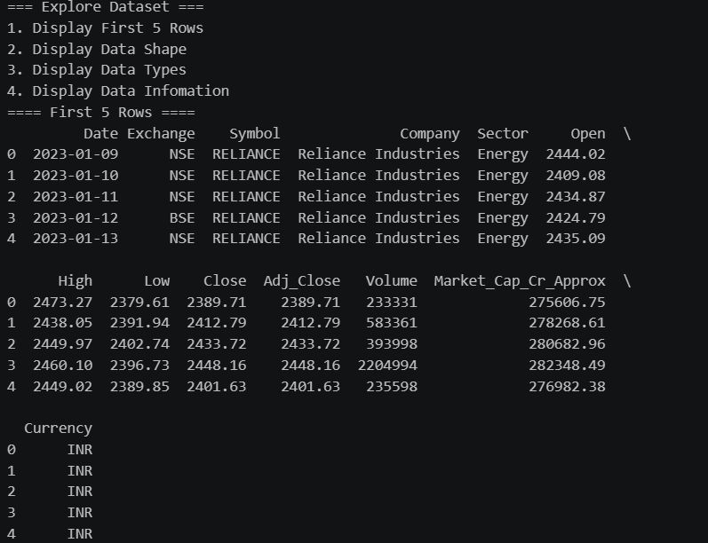

# Stock Market Analysis

Exploratory analysis and visualization of historical stock market data using Python.

## Tools & Libraries

- Pandas
- NumPy
- Matplotlib
- Seaborn

# Tools
- python
- Github
- git

## Dataset

- **Source:** Historical data downloaded with `yfinance`, or a CSV from Kaggle.
- **Columns:** Date, Open, High, Low, Close, Adj Close, Volume.

## Project Workflow

### 1. Load Dataset
- Download historical data using `yfinance`.
- Alternatively, read a Kaggle CSV with Pandas.

### 2. Explore Dataset
- Display first 5 rows
- Check shape
- Display column names
- Check data types
- Display dataset info

### 3. Data Cleaning
- Handle missing values
- Remove duplicate records
- Convert `Date` column to datetime
- Check for invalid stock prices

### 4. Data Analysis
- Analyze Open, High, Low, Close and Adjusted Close prices
- Analyze trading volume
- Calculate daily price changes
- Calculate moving averages
- Identify highest and lowest prices

### 5. Data Visualization
- Line chart: Closing price over time
- Line chart: Opening price over time
- Line chart: Moving averages
- Bar chart: Trading volume
- Candlestick chart: Price movements
- Scatter plot: Trading volume vs Closing price

### 6. Analyze Results
- Identify price trends
- Compare stock performance over time
- Analyze moving average patterns
- Identify periods of high trading volume

## Installation

```bash
pip install pandas numpy matplotlib seaborn 
```

## Usage

```bash
git clone <your-repo-url>
cd stock-market-analysis
jupyter notebook stock_market_analysis.ipynb
```

## Output Image




## Project Structure

```
├── main.ipynb
├── output.png
├── data.csv
└── README.md
```
## Author
``` Adnan ```